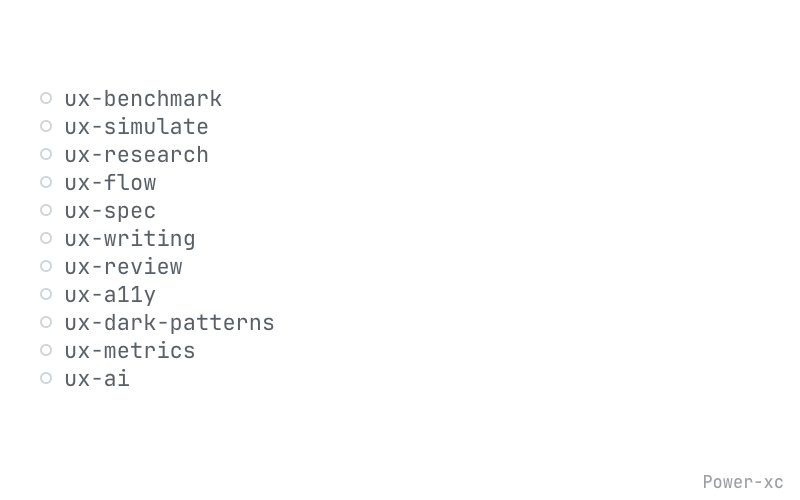
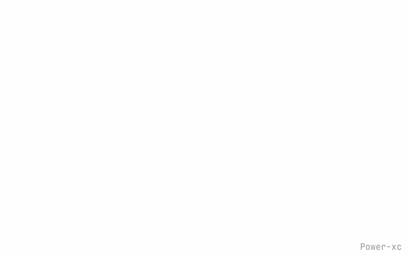

<picture>
  <source media="(prefers-color-scheme: dark)" srcset="https://readme-typing-svg.demolab.com?font=Poppins&weight=700&size=28&duration=2000&pause=1000&repeat=false&width=280&height=44&color=FFFFFF&lines=KangKeun+Park" />
  <source media="(prefers-color-scheme: light)" srcset="https://readme-typing-svg.demolab.com?font=Poppins&weight=700&size=28&duration=2000&pause=1000&repeat=false&width=280&height=44&color=1F2328&lines=KangKeun+Park" />
  
</picture>

**Senior Product Designer (AI · B2B) who prototypes in code**  
복잡한 AI·B2B 제품을 사용자가 이해하고 실행할 수 있는 경험으로 설계하고, 기획부터 배포까지 직접 만들어 검증합니다.

 

🛠 **Now** — 피부·두피·다이어트 기록부터 성분 대조, 업체 맵, 비슷한 케이스 커뮤니티까지 잇는 케어 서비스 [모하우](https://www.mohow.co.kr)를 운영하며, 직접 학습한 정수리(탈모) 세그멘테이션 모델을 얹고 있습니다.

##  About Me

- AI 에이전트와 자동화 워크플로를 설계해 아이디어를 동작하는 제품으로 빠르게 만듭니다.
- 사용자가 이해하고 실행할 수 있는 경험을 기준으로 AI의 역할과 범위를 정합니다.
- 문제를 충분히 정의하고, 제약과 리소스를 고려해 우선순위 높은 가설을 데이터로 검증합니다.
- 새로운 기술의 가능성을 직접 실험하고 검증합니다.

##  Featured Projects

<table>
<tr>
<td width="50%" valign="top">
<a href="https://github.com/Power-xc/power-ux-harness"><b>power-ux-harness</b></a> 
<a href="https://github.com/Power-xc/power-ux-harness"><picture>
<source media="(prefers-color-scheme: dark)" srcset="https://raw.githubusercontent.com/Power-xc/Power-xc/main/assets/featured/power-ux-harness-dark.gif" />

</picture></a> 
같은 기능도 서비스마다 정답이 다르다. AI 코딩 에이전트가 규모·타깃·나이·상황부터 읽고 시니어 프로덕트 디자이너의 절차로 UX를 설계·검토하게 하는 스킬 11개. 비슷한 서비스 사례를 맥락에 맞춰 가져오는 벤치마킹(ux-benchmark)과 합성 페르소나 시뮬레이션부터 흐름·화면 설계서·문구·리뷰·접근성·기만 패턴·지표까지 같은 판정으로 잇습니다.  
    
<a href="https://github.com/Power-xc/power-ux-harness">Repo</a> · <a href="https://power-ux-harness-guide.vercel.app">Skill Guide</a>
</td>
<td width="50%" valign="top">
<a href="https://github.com/Power-xc/usage-gauge"><b>usage-gauge</b></a> 
<a href="https://github.com/Power-xc/usage-gauge"><picture>
<source media="(prefers-color-scheme: dark)" srcset="https://raw.githubusercontent.com/Power-xc/Power-xc/main/assets/featured/usage-gauge-dark.gif" />

</picture></a> 
쓰는 모든 AI의 남은 한도를, 언제 바닥나는지까지. Claude·Codex 등 100여 개 서비스의 남은 사용량과 초기화 시각을 화면 위 게이지와 메뉴바에 띄우고, 그래프 12종·스타일 3종 중에서 고릅니다. macOS·Windows.  
    
<a href="https://github.com/Power-xc/usage-gauge">Repo</a> · <a href="https://github.com/Power-xc/usage-gauge/releases/latest">Download</a>
</td>
</tr>
<tr></tr>
<tr>
<td width="50%" valign="top">
<a href="https://github.com/Power-xc/power-persona-sim"><b>Persona Sim</b></a> 
<a href="https://github.com/Power-xc/power-persona-sim"><picture>
<source media="(prefers-color-scheme: dark)" srcset="https://raw.githubusercontent.com/Power-xc/Power-xc/main/assets/featured/power-persona-sim-dark.gif" />

</picture></a> 
NVIDIA Nemotron 100만 합성 페르소나로 설문·심층인터뷰를 시뮬레이션하고, LLM 응답을 분포 적합도·known-truth·자기일관성·멀티모델 교차로 검증합니다. 알려진 정답이나 분포 검증에 실패하면 결과 전체를 버립니다.  
   
<a href="https://github.com/Power-xc/power-persona-sim">Repo</a>
</td>
<td width="50%" valign="top">
<a href="https://github.com/Power-xc/ux-measure-lab"><b>UX MeasureLab</b></a> 
<a href="https://github.com/Power-xc/ux-measure-lab"><picture>
<source media="(prefers-color-scheme: dark)" srcset="https://raw.githubusercontent.com/Power-xc/Power-xc/main/assets/featured/ux-measure-lab-dark.gif" />

</picture></a> 
질문 하나로 측정을 자동 구성해 가설 → 사전 등록 실험 → 사람의 결정으로 잇는 워크스페이스. AI는 후보를 제안하고, 판정은 코드가 합니다.  
   
<a href="https://github.com/Power-xc/ux-measure-lab">Repo</a> · <a href="https://ux-measure-lab.vercel.app">Live Demo</a>
</td>
</tr>
<tr></tr>
<tr>
<td width="50%" valign="top">
<a href="https://github.com/Power-xc/nirguard"><b>NIRGuard</b></a> 
<a href="https://github.com/Power-xc/nirguard"><picture>
<source media="(prefers-color-scheme: dark)" srcset="https://raw.githubusercontent.com/Power-xc/Power-xc/main/assets/featured/nirguard-dark.gif" />

</picture></a> 
화면을 카메라로 재촬영한 유출본을 리뷰 세션까지 역추적하는 포렌식 워터마킹 검증 랩. 불확실하면 지목하지 않는 신뢰도 정책을 둡니다. (특허 출원 중)  
   
<a href="https://github.com/Power-xc/nirguard">Repo</a>
</td>
<td width="50%" valign="top">
<a href="https://github.com/Power-xc/notion-jira-sync"><b>notion-jira-sync</b></a> 
<a href="https://github.com/Power-xc/notion-jira-sync"><picture>
<source media="(prefers-color-scheme: dark)" srcset="https://raw.githubusercontent.com/Power-xc/Power-xc/main/assets/featured/notion-jira-sync-dark.gif" />

</picture></a> 
Notion 프로젝트 DB를 원천으로 Jira 이슈와 Confluence 주간보고를 자동 생성·갱신하는 CLI. 기본 dry-run, 실제 쓰기는 --apply로만.  
    
<a href="https://github.com/Power-xc/notion-jira-sync">Repo</a>
</td>
</tr>
</table>

##  Tech Stack

### AI & Agent Workflow

### AI Video & Creative

### Product Design

### Build & Ship

##  Certifications

-  **Certified Generative AI Engineer Associate** · 2026
-  **Certified Data Engineer Associate** · 2026
-  **NCS 디지털디자인 (Digital Design) L5** · 한국산업인력공단 · 2021

##  GitHub

<picture>
  <source media="(prefers-color-scheme: dark)" srcset="https://raw.githubusercontent.com/Power-xc/Power-xc/output/top-langs-dark.svg" />
  <source media="(prefers-color-scheme: light)" srcset="https://raw.githubusercontent.com/Power-xc/Power-xc/output/top-langs.svg" />
  
</picture>

<picture>
  <source media="(prefers-color-scheme: dark)" srcset="https://raw.githubusercontent.com/Power-xc/Power-xc/output/github-snake-dark.svg" />
  <source media="(prefers-color-scheme: light)" srcset="https://raw.githubusercontent.com/Power-xc/Power-xc/output/github-snake.svg" />
  
</picture>
